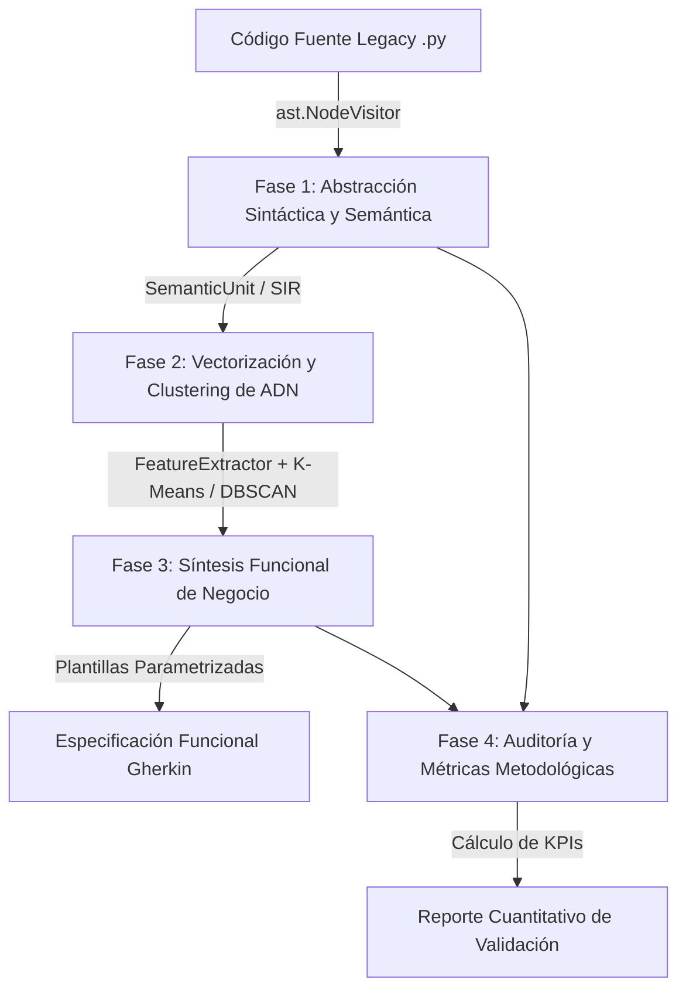

# SIR-FE: Semantic Intermediate Representation for Functional Extraction
### *Ingeniería Inversa Asistida por AST, Representación Semántica y Clustering de Comportamiento*


---

## 📌 Resumen Ejecutivo

**SIR-FE** (*Semantic Intermediate Representation for Functional Extraction*) es un proyecto de **investigación aplicada e ingeniería de software avanzada** diseñado para reducir la brecha semántica entre el código fuente heredado (*legacy*) y las especificaciones funcionales de negocio.

A través de un pipeline automatizado de cuatro etapas, la herramienta:
1. Inspecciona estáticamente el **Árbol de Sintaxis Abstracta (AST)** de aplicaciones Python.
2. Construye una **Representación Intermedia Semántica (SIR)** desacoplada del lenguaje.
3. Agrupa unidades de código afines mediante **algoritmos de aprendizaje no supervisado (Clustering)** basados en sus firmas de comportamiento.
4. Sintetiza capacidades de negocio y **escenarios de prueba en formato Gherkin (BDD)** con trazabilidad técnica bidireccional código-requisito.

> **Propósito del Repositorio**: Este proyecto sirve como demostración técnica de competencias en **análisis estático de código, diseño de compiladores/IRs, aprendizaje automático aplicado a software (ML4SE), patrones de arquitectura limpia y reingeniería de sistemas**.

---

## 💡 Competencias Técnicas Demostradas

* **Análisis Estático de Código y Compiladores**: Uso avanzado del módulo nativo `ast` de Python, patrones *Visitor/Walker*, análisis intraprocedural de flujo de control, detección de precondiciones y efectos colaterales (mutaciones de memoria, persistencia y eventos).
* **Machine Learning & Feature Engineering**: Transformación de grafos sintácticos en matrices multidimensionales (*One-Hot*, *Multi-Hot* y ponderación por *Confidence Scores*). Implementación de estrategias intercambiables de agrupamiento (*K-Means*, *Agglomerative Clustering*, *DBSCAN*).
* **Arquitectura de Software y Clean Code**: Diseño modular fuertemente tipado (`dataclasses`, `typing`), separación estricta de responsabilidades, extensibilidad mediante perfiles JSON y ejecución en memoria (*zero side-effects*).
* **Metodologías Ágiles y Calidad de Software (BDD)**: Reingeniería inversa orientada a comportamiento (*Behavior-Driven Development*), generación de historias de usuario y trazabilidad granular a nivel de archivo y número de línea.
* **Rigor Metodológico y Auditoría**: Módulo de telemetría y KPIs que evalúa cuantitativamente la cobertura de unidades, la densidad de roles y el índice de honestidad heurística.

---

## 🏗️ Arquitectura del Pipeline

El sistema opera bajo una arquitectura de flujo unidireccional (*Pipes & Filters*) con cuatro fases claramente diferenciadas:



### Detalle de Fases:
1. **Abstracción Sintáctica a SIR (`analizar_codigo_legacy.py`)**: Recorre clases y métodos abstrayendo llamadas, variables de retorno, excepciones capturadas/lanzadas y sentencias condicionales (`If`/`Assert`) para inferir roles como `VALIDATOR`, `PERSISTER`, `TRANSFORMER` o `EXTRACTOR`.
2. **Representación y Agrupamiento (`clustering_ir.py`)**: El `FeatureExtractor` proyecta las unidades semánticas en un espacio vectorial multidimensional considerando roles, dominios, llamadas de red/base de datos y mutaciones de estado, agrupando métodos complementarios.
3. **Síntesis Funcional BDD (`generar_json_negocio.py`)**: Agrega las propiedades semánticas del cluster para sintetizar una Historia de Usuario estandarizada y un escenario Gherkin (`Dado / Cuando / Entonces / Y`) con respaldo técnico explícito.
4. **Validación y Métricas (`validar_metodologia.py`)**: Calcula índices de cobertura de código, confianza heurística promedio y niveles de precondiciones para auditoría técnica.

---

## 🔬 Rigor Metodológico: Heurísticas vs. Validación Experimental

Como proyecto de investigación y buena práctica de ingeniería sénior, el proyecto define explícitamente la frontera entre lo que se deduce mediante **análisis estático heurístico** y lo que requiere **validación empírica experimental**:

| Dimensión Técnica | Implementado por Heurísticas Estáticas (AST) | Validación Empírica & Trabajo Futuro (Roadmap) |
| :--- | :--- | :--- |
| **Clasificación de Roles** | Asignación basada en patrones sintácticos (`raise`/`assert` $\to$ `VALIDATOR`; llamadas CRUD $\to$ `PERSISTER`; bucles $\to$ `TRANSFORMER`). | Medición empírica de **Precisión, Recall y F1-Score** frente a un *Ground Truth* etiquetado por ingenieros de software. |
| **Inferencia de Invariantes** | Extracción textual de condiciones de guardia en ramas condicionales tempranas y sentencias `assert`. | **Análisis dinámico y ejecución simbólica** para verificar la completitud y satisfacibilidad de las precondiciones en runtime. |
| **Contexto de Dominio** | Concordancia léxica en diccionarios configurables (`config_analizador.json`) sobre identificadores de métodos y clases. | Integración con **Modelos de Lenguaje (LLMs / Code Embeddings)** para desambiguar dominios en nomenclaturas no estandarizadas. |
| **Cohesión de Clusters** | Vectorización matricial y agrupamiento por distancia euclidiana o densidad. | **Validación de calidad intrínseca** (Silhouette score) y contraste contra la arquitectura modular documentada del sistema. |
| **Escenarios Gherkin** | Síntesis generativa paramétrica agregando acciones, estados y excepciones de cada cluster. | **Pruebas de usuario con expertos de dominio** (legibilidad y valor funcional) y **ejecución dinámica de los tests** (*Behave* / *pytest-bdd*). |
| **Profundidad de Análisis** | Análisis estático intraprocedural con trazabilidad de llamadas directas. | **Análisis interprocedural y análisis de alias (Points-to analysis)** para propagación de flujo entre capas y microservicios. |

---

## ⚡ Guía de Inicio Rápido (Quickstart)

### 1. Clonar el Repositorio e Instalar Dependencias
```bash
git clone https://github.com/tu-usuario/SIRFE.git
cd SIRFE
pip install -r requirements.txt
```

### 2. Ejecutar Ejemplo Mínimo Reproducible
El repositorio incluye un caso de estudio autocontenido ([`ejemplos/servicio_autenticacion.py`](file:///c:/Users/gustavo/Dropbox/SIRFE/ejemplos/servicio_autenticacion.py)) que ejemplifica autenticación, gestión de sesión, saneamiento de datos y persistencia:

```bash
python orquestador.py ejemplos/servicio_autenticacion.py --output-dir salida_demo
```

**Salida Consolidada en Terminal:**
```text
============================================================
INICIANDO PIPELINE SIR-FE
Ruta objetivo: ejemplos/servicio_autenticacion.py
Configuración: config_analizador.json
============================================================

[Paso 1/4] Analizando código fuente y abstrayendo AST a IR...
-> Se extrajeron 5 métodos con representaciones semánticas.

[Paso 2/4] Agrupando comportamientos similares (Clustering K-Means)...
-> Se generaron 4 clusters basados en firmas semánticas.

[Paso 3/4] Sintetizando capacidades funcionales e historias de usuario...
-> Se sintetizaron 4 capacidades funcionales.

[Paso 4/4] Validando metodología y calculando KPIs...

[OK] Archivos de salida escritos exitosamente en 'salida_demo':
  - Representación Semántica: salida_demo/representacion_intermedia_semantica.json
  - Clusters de Comportamiento: salida_demo/clusters_ir.json
  - Especificación Funcional (Gherkin): salida_demo/especificacion_funcional.json
  - Reporte de Tesis (KPIs): salida_demo/reporte_validacion_tesis.json

==================================================
REPORTE CONSOLIDADO DE VALIDACIÓN (SIR-FE)
==================================================
Total unidades analizadas  : 5
Unidades mapeadas a caps   : 5
Cobertura de Unidades      : 100.00%
Confianza Promedio (SIR)   : 0.86
Líneas de Código Totales   : 34
Cobertura Precondiciones   : 80.00%
--------------------------------------------------
Distribución de Roles Semánticos:
  - EXTRACTOR   : 5
  - VALIDATOR   : 4
  - PERSISTER   : 1
  - TRANSFORMER : 1
==================================================
```

### 3. Ejecución Quirúrgica sobre Código Legacy Real
El pipeline permite analizar módulos legacy reales de forma masiva o granular:

```bash
# Análisis completo de un módulo legacy
python orquestador.py legacy/trytond/security.py

# Análisis en memoria (sin escribir archivos en disco)
python orquestador.py legacy/trytond/security.py --no-write

# Análisis focalizado en un único método
python orquestador.py legacy/trytond/security.py --method check
```

---

## 🧪 Suite de Pruebas Automatizadas

El proyecto cuenta con un conjunto integral de pruebas unitarias y de integración implementado sobre `unittest` nativo de Python:

```bash
python -m unittest discover -s tests -p "test_*.py" -v
```

### Módulos de Prueba:
| Test Suite | Cobertura Funcional |
| :--- | :--- |
| [`test_analizador.py`](file:///c:/Users/gustavo/Dropbox/SIRFE/tests/test_analizador.py) | Parseo de AST, asignación de roles heurísticos, extracción de guards/asserts y detección de mutaciones (`self.*`, CRUD). |
| [`test_clustering.py`](file:///c:/Users/gustavo/Dropbox/SIRFE/tests/test_clustering.py) | Vectorización mediante `FeatureExtractor`, consistencia dimensional de matrices y algoritmos de agrupamiento. |
| [`test_sintesis_negocio.py`](file:///c:/Users/gustavo/Dropbox/SIRFE/tests/test_sintesis_negocio.py) | Generación de historias de usuario, escenarios Gherkin (`Dado/Cuando/Entonces`) y trazabilidad técnica. |
| [`test_validacion.py`](file:///c:/Users/gustavo/Dropbox/SIRFE/tests/test_validacion.py) | Cómputo de KPIs metodológicos, porcentajes de cobertura, promedios de confianza y control de listas vacías. |
| [`test_pipeline_integracion.py`](file:///c:/Users/gustavo/Dropbox/SIRFE/tests/test_pipeline_integracion.py) | Prueba *end-to-end* que ejecuta los 4 pasos del pipeline en memoria de forma orquestada. |

---

## 📂 Organización del Proyecto

```text
SIRFE/
├── orquestador.py                  # CLI principal y coordinador del pipeline
├── analizar_codigo_legacy.py       # Extractor de AST y generador de la SIR
├── clustering_ir.py                # Extracción de características y algoritmos ML
├── generar_json_negocio.py         # Motor de síntesis funcional y generación BDD
├── validar_metodologia.py          # Auditoría, KPIs y cálculo de métricas de tesis
├── modelos.py                      # Entidades del dominio fuertemente tipadas (Dataclasses)
├── config_analizador.json          # Perfiles léxicos y configuración de heurísticas
├── requirements.txt                # Dependencias del entorno (scikit-learn, numpy, scipy)
├── ejemplos/
│   └── servicio_autenticacion.py   # Caso de estudio mínimo reproducible
├── tests/
│   ├── test_analizador.py
│   ├── test_clustering.py
│   ├── test_sintesis_negocio.py
│   ├── test_validacion.py
│   └── test_pipeline_integracion.py
├── documentacion/                  # Fundamentos metodológicos y estado del arte
│   ├── ESTADO_DEL_ARTE.md
│   ├── MARCO_TEORICO.md
│   └── METODOLOGIA.md
└── legacy/                         # Directorio destinado a bases de código bajo análisis
    └── .gitkeep
```

---

## 📄 Licencia y Citación

Desarrollado como prototipo de investigación en Reingeniería de Software. Distribuido bajo la licencia [MIT](LICENSE) (o aplicable al proyecto).
